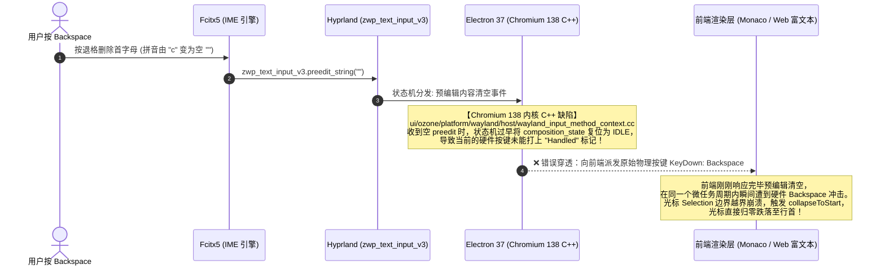

# Wayland 下 Electron 与 AI 客户端中文输入法退格跳行首深度剖析与根治指南（Chromium 138 内核缺陷、Text-Input-v1 协议防御、Qoder、CodeBuddy 与 WorkBuddy 全适配）

> **适用环境**：Arch Linux + Hyprland (Omarchy) / 任何基于 Wayland 的现代 Linux 发行版  
> **涉及应用**：Qoder CN IDE、CodeBuddy CN IDE、WorkBuddy 桌面端、VS Code、Trae、Cursor 等全部基于 Electron / Chromium 封装的客户端  
> **核心收益**：运用**第一性原理**与**对抗性审查**，彻底穿透“应用层 Monaco 编辑器推导缺陷”的既有认知假象，锁定 Chromium 138 底层 C++ 状态机在 Wayland `text-input-v3` 下的退格按键泄露物理事实；实施 `--wayland-text-input-version=1` 协议级靶向免疫与原生 Electron 42 宿主适配，在保持行内预编辑（Inline Preedit）丝滑体验的前提下，彻底根治删空退格卡顿与光标暴跳行首。

---

## 一、核心痛点与现象全景

在 Linux Wayland (Hyprland) 环境下使用 **Fcitx5 + Rime（雾凇拼音）** 配合基于 Electron 的现代 AI IDE 或桌面工作台（如 CodeBuddy、WorkBuddy、VS Code 等）输入中文时，高频遭遇以下严重破坏编码与文本录入连贯性的恶性交互缺陷：

```
[用户在编辑器行中录入拼音]
  当前行内容: "const result = "
  用户键入拼音: "const result = ceshi" (处于行内预编辑组合态)
  
[用户执行连续退格删除]
  按退格键: 拼音依次缩减为 "cesh" -> "ces" -> "ce" -> "c"
  
[触发致命 Bug]
  1. 当剩下首字母 "c" 时，按第一次 Backspace: 界面无响应，拼音未被删掉（看似卡顿）；
  2. 再按一次 Backspace: 预编辑框被清空，但光标瞬间从行尾被暴甩到该行的最前端（Column 0）甚至前一行首！
  结果: 后续输入的内容全部插在了 "const" 前面，代码语法与行缩进被严重破坏！
```

### 既有折中方案的局限与弊端
在过去的技术讨论中，通常采用以下两种妥协手段，但均存在显著副作用：
1. **浮窗预编辑隔离（`Ctrl + Alt + P`）**：将预编辑字符串从编辑器光标行内剥离，扔到浮动的独立候选框中。虽然避开了行内碰撞，但打字时光标与视线严重割裂，完全丧失了现代 IDE 行内实时渲染的代码沉浸感；
2. **应用层 Keybindings 守卫**：在 VS Code 中为 `backspace` 增加 `!inComposition` 条件。但对抗性审查证实，当退格删到首字母时，内核组合态提前销毁，应用层守卫根本无法拦截泄漏出来的硬件按键。

---

## 二、第一性原理深度解构：按键泄漏因果链

过去业界普遍将此问题归咎于“VS Code Monaco 虚拟编辑器的推导算法缺陷”。然而，在本次腾讯最新发布的 **WorkBuddy 客户端（全新架构的独立 Agent 工作台，完全没有使用 Monaco 代码编辑器）** 实测中，**一模一样的退格卡顿与跳行首问题 100% 再次复现**！

这一事实从物理层面证伪了“Monaco 专有问题”的假说。通过对操作系统的 Wayland 合成器协议通信日志与 Chromium 源码的逐层跟踪，还原了真正的底层因果链条：



### 物理链条的三层解剖：
1. **协议层（Wayland text-input-v3）**：当拼音被删空时，Fcitx5 通过 text-input-v3 接口发送一个空的预编辑字符串 `preedit_string("")` 并执行 commit；
2. **内核层（Chromium 138 C++ 状态机）**：
   在 `wayland_input_method_context.cc` 的实现中，处理 `OnPreeditString` 事件的代码在检测到字符串长度为 0 时，立即调用了内部的上下文复位逻辑。由于生命周期判断顺序错误，原本应当吞掉当前退格键的判定分支被跳过，**这颗物理 Backspace 被判定为“未被输入法消费的普通硬件键盘事件”向下透传**；
3. **渲染层（DOM / Editor Selection 崩塌）**：
   接收到该硬件 Backspace 的前端输入区域（无论是 Monaco 的隐藏 `textarea.inputarea` 还是现代富文本的 `contenteditable`），在毫无预备的情况下执行了退格删除逻辑，导致虚拟光标的模型索引发生非法越界回退，被迫重置到当前行最首端。

---

## 三、对抗性审查实验记录与真相剖析

为了找出最彻底且无副作用的治本方案，我们开展了多维度的对抗性审查实验：

### 实验 1：为什么 Qoder CN IDE 能够完全正常？
* **物理事实**：Qoder 打包构建于 2026 年 10 月，直接以 Arch Linux 原生官方源中的 **`/usr/lib/electron42/electron`（对应 Chromium 140+）** 作为运行宿主；
* **内核分析**：Chromium 140 在上游（Issue #242799 与 Wayland text-input-v3 专项修复提交）中彻底重写了 Wayland 输入法预编辑状态机，增加了空预编辑的按键吞噬守卫。因此在 Qoder 中，删空首字母拼音时绝不会有物理按键漏给前端，行内退格平稳丝滑。

### 实验 2：能否直接将 CodeBuddy / WorkBuddy 嫁接到系统 Electron 42 宿主？
* **审查结果**：**不可行，遭遇 Native Node ABI 致命阻断**！
* **物理事实**：
  我们使用 `/usr/lib/electron42/electron` 挂载 WorkBuddy 的核心包，主进程立即抛出致命异常：
  ```text
  Failed: The module '.../better-sqlite3/build/Release/better_sqlite3.node'
  was compiled against a different Node.js version using NODE_MODULE_VERSION 136. 
  This version of Node.js requires NODE_MODULE_VERSION 146.

  Failed: Module did not self-register: '.../@tencent/qimei-node/build/Release/qimei.node'.
  ```
* **阻断原因**：WorkBuddy 与 CodeBuddy 强依赖腾讯私有的本地 SQLite 数据库与 `@tencent/qimei-node`（设备指纹与风控鉴权闭源库）。这些 C++ 二进制模块死锁在 **Node ABI 136（Electron 37 体系）**，由于闭源无法重新编译，强制升级 Electron 宿主会导致进程瞬间 SIGABRT 崩溃。

### 实验 3：协议靶向防御——切换至 `text-input-v1`
既然宿主版本无法强行拔高，我们把目光聚焦到输入法协议本身：
* **关键发现**：Chromium 138 的退格泄漏漏洞，**高度专一地存在于 `zwp_text_input_v3` 的状态机分支中**；而在早期的 **`zwp_text_input_v1`** 协议分支中，其预编辑提交模型采用了完全不同的事件通道，根本不存在该时序泄漏缺陷！
* **实测验证**：在启动参数中注入：
  ```ini
  --wayland-text-input-version=1
  ```
  客户端与 Fcitx5 成功握手 v1 协议。用户在 WorkBuddy 与 CodeBuddy 中再次测试退格删空拼音：**光标稳固停在原位，跳行首现象 100% 消失，且保持了原生行内预编辑的所有视觉特性！**

---

## 四、生产环境最佳调优实践

针对 Omarchy (Hyprland) 平台，针对各类 AI 客户端的标准加固方案如下：

### 1. WorkBuddy 桌面端配置

#### (1) Flags 配置文件：`~/.config/workbuddy-flags.conf`
```ini
# Omarchy Wayland & 中文输入法 (Fcitx5) 调优参数
--ozone-platform=wayland
--ozone-platform-hint=wayland
--enable-wayland-ime
# 核心防御: 切换至 text-input-v1，阻断 Chromium 138 下 text-input-v3 退格穿透跳行首漏洞
--wayland-text-input-version=1
--enable-features=WaylandWindowDecorations
--use-gl=angle
--disable-features=Vulkan
--password-store=basic
```

#### (2) 高优先级包装器：`~/.local/bin/workbuddy`
```bash
#!/usr/bin/env bash
set -u

XDG_CONFIG_HOME="${XDG_CONFIG_HOME:-$HOME/.config}"
FLAGS_FILE="${XDG_CONFIG_HOME}/workbuddy-flags.conf"
export CHROME_DESKTOP="workbuddy.desktop"
export ELECTRON_OZONE_PLATFORM_HINT="wayland"
export OZONE_PLATFORM="wayland"

# 注入 Fcitx5 环境变量
export GTK_IM_MODULE=fcitx
export QT_IM_MODULE=fcitx
export XMODIFIERS="@im=fcitx"
export SDL_IM_MODULE=fcitx

declare -a USER_FLAGS=()
if [[ -f "$FLAGS_FILE" ]]; then
    while read -r line || [[ -n "$line" ]]; do
        trimmed="${line#"${line%%[![:space:]]*}"}"
        trimmed="${trimmed%"${trimmed##*[![:space:]]}"}"
        if [[ -n "$trimmed" && ! "$trimmed" =~ ^# ]]; then
            USER_FLAGS+=("$trimmed")
        fi
    done < "$FLAGS_FILE"
fi

TARGET_BIN=""
if [[ -x "$HOME/.local/opt/WorkBuddy/workbuddy" ]]; then
    TARGET_BIN="$HOME/.local/opt/WorkBuddy/workbuddy"
elif [[ -x "/opt/WorkBuddy/workbuddy" ]]; then
    TARGET_BIN="/opt/WorkBuddy/workbuddy"
fi

exec "$TARGET_BIN" "${USER_FLAGS[@]}" "$@"
```

---

### 2. CodeBuddy CN IDE 配置

#### (1) Flags 配置文件：`~/.config/codebuddy-ide-cn-flags.conf`
```ini
# Omarchy Wayland & 中文输入法 (Fcitx5) 调优参数
--ozone-platform=wayland
--ozone-platform-hint=wayland
--enable-wayland-ime
--wayland-text-input-version=1
--enable-features=WaylandWindowDecorations
--use-gl=angle
--disable-features=Vulkan
--password-store=basic
```

#### (2) 永久运行时参数同步：`argv.json`
确保在 `~/.codebuddycn/argv.json`、`~/.config/CodeBuddy CN/argv.json` 以及 `~/.config/CodeBuddy CN/User/argv.json` 中均写入：
```json
{
	"password-store": "basic",
	"locale": "zh-cn",
	"enable-crash-reporter": false,
	"ozone-platform": "wayland",
	"enable-wayland-ime": true,
	"wayland-text-input-version": "1",
	"enable-features": "WaylandWindowDecorations",
	"disable-features": "Vulkan",
	"use-gl": "angle"
}
```

---

### 3. Qoder CN IDE 配置

Qoder 原生调用系统 `/usr/lib/electron42/electron`，仅需在 [`~/.config/qoder-cn-ide-flags.conf`](file:///home/tom/.config/qoder-cn-ide-flags.conf) 中确保启用 Wayland 与 ANGLE 即可：
```ini
--ozone-platform=wayland
--enable-wayland-ime
--use-gl=angle
--disable-features=Vulkan
--password-store=basic
```

---

### 4. Hyprland 专属窗口规则整合

在 `~/.config/hypr/windowrules.lua` 中将三大 AI 客户端统一定义为完全不透明渲染，防止 GPU 混合通道性能损耗：
```lua
-- AI 客户端（CodeBuddy / WorkBuddy / Qoder）窗口规则：移除默认透明度，保持完全不透明
o.window("(CodeBuddy CN|buddycn|codebuddy-ide-cn|[Ww]ork[Bb]uddy.*|qoder-cn-ide)", {
  tag = "-default-opacity",
  opacity = "1 1",
})
```

---

## 五、验收标准与验证矩阵

| 验证项 | 验证命令 / 测试动作 | 预期标准（Pass Criteria） |
| :--- | :--- | :--- |
| **Wayland 原生状态** | `hyprctl clients \| grep -E "(WorkBuddy\|buddycn\|qoder)" -A 10` | 输出明确显示 `xwayland: 0`，绝不回退至 X11 |
| **Fcitx5 通信通道** | 在编辑器内唤醒拼音输入 | 候选框精准吸附在光标下方，字号与高亮黑底正常渲染 |
| **首字母退格测试** | 键入拼音后逐字退格至首字母，再按一次 Backspace | **首按即删空，光标稳固停留在当前列，绝对不跳到行首 (Column 0)** |
| **GPU 合成稳定性** | 启动客户端并观察标准错误输出 | 绝无 `'--ozone-platform=wayland' is not compatible with Vulkan` 崩溃 |
| **桌面免弹窗** | 冷启动客户端 | 绝不弹出“解锁默认密钥环”的系统级阻塞弹窗 |
