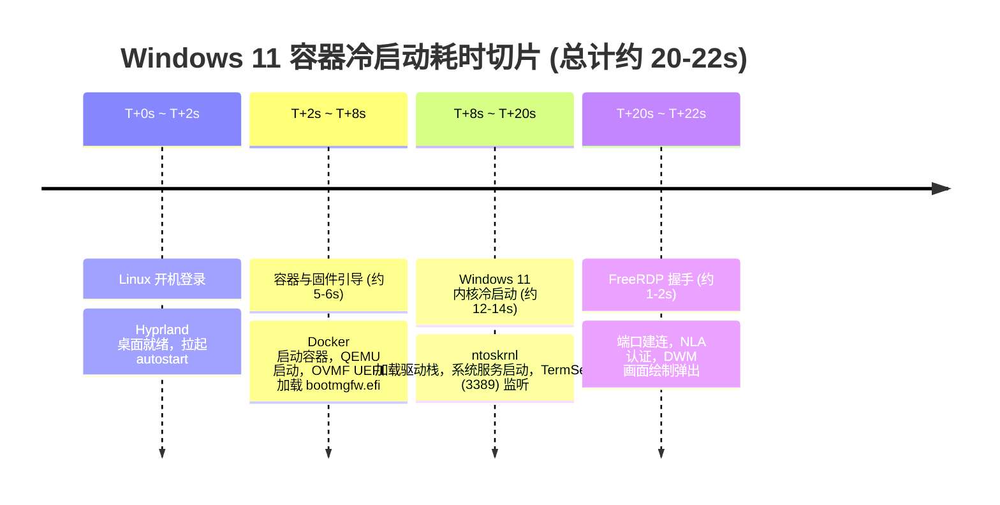

# Windows 容器虚拟机性能与宿主机内存全栈治理实录
> 涵盖：16GB 宿主机内存与分级 Swap 架构、Chromium 渲染器崩溃（代码 9）根因排查、Btrfs 磁盘碎片消除、QEMU Writeback 与 VirtIO Balloon、6 vCPU 超线程扩容、开机 20 秒延迟第一性原理拆解与休眠挂起“0 秒即开”工作流。

---

## 一、 问题背景与核心痛点

在 Omarchy (Arch Linux + Hyprland) 环境下，运行基于 Docker + KVM/QEMU (`dockurr/windows`) 的 Windows 11 虚拟机，是满足深信服 VPN、企业微信及专用办公软件的关键方案。

在 16GB 物理内存的设备（Intel Core i5-1135G7，4核8线程）上，保障 6GB 物理内存专供给 Windows 虚拟机后，宿主机与虚拟机面临两个典型的性能瓶颈：

| 故障 / 痛点现象 | 表象特征 | 深度排查前的认知偏见 |
| :--- | :--- | :--- |
| **痛点 1：AI IDE / 浏览器频繁崩溃 (代码 9)** | CodeBuddy CN 与 Qoder CN 运行中频繁弹窗：“窗口意外终止 (原因: 'killed', 代码: '9')”，终端重连闪退。 | 普遍误以为是 Linux 内核 OOM Killer 杀死了进程，或者 IDE 存在未捕获的内存泄露。 |
| **痛点 2：开机冷启动缓慢，等待约 20 秒** | 开机进入桌面后，自启动的 Windows 虚拟机窗口需要静默等待 20 秒左右才弹出来，严重打断即开即用的工作流。 | 误以为是 Docker 容器网络或启动脚本存在未知的超时重试卡顿。 |

---

## 二、 第一性原理与对抗性审查全景诊断

### 1. 痛点 1 深度解构：IDE 崩溃（退出代码 9）到底是谁杀的？

通过第一性原理追溯底层操作系统指标：
1. **排查内核 OOM Killer**：
   查看 `/proc/vmstat` 中的 `oom_kill` 指标，发现计数为 **0**；查看 `dmesg -T` 和 `journalctl -k`，没有任何 `Out of memory: Kill process` 记录。证明**操作系统内核并没有触发 OOM-Killer**。
2. **定位真凶——Chromium 渲染器看门狗**：
   Electron / Chromium 内部维护着一个线程挂起看门狗（Unresponsive Hang Watchdog）。当宿主机内存极度紧张、发生频繁换页停顿时，如果渲染器主线程超过阈值没有响应心跳，浏览器主进程就会主动向该渲染器子进程发送 `SIGKILL`（信号代码 9）予以强杀。
3. **内存账单真相：无限制的 zram 吞噬了物理内存**：
   - 宿主机配置了默认的 `zram-generator`，没有设置容量上限，导致 `/dev/zram0` 压缩空间一路膨胀到了 **8.8GB**。
   - zram 存储的是经过压缩的数据，但**这些数据本身依然占据着宿主机的物理 RAM**（8.8GB zram 实际吃掉了约 2.0GB 物理 RAM）。
   - 与此同时，NVMe 固态硬盘上的 `/swap/swapfile` 优先级较低（或未配置换页策略），使用量几乎为 0。
   - 物理可用内存被压缩到不足 500MB，提交内存（`Committed_AS`）超过 60GB，导致严重的内存颠簸（Memory Thrashing），直接引发 Chromium 看门狗杀进程。

---

### 2. 痛点 2 深度解构：开机 20 秒等待到底消耗在哪里？

从物理执行链路上，对冷启动时间线进行毫秒级切片：



- **不可逾越的物理事实**：
  Windows 11 是一个 20GB 大小、包含数万个驱动文件和系统服务的完整操作系统。在通过 Windows 事件日志（`Microsoft-Windows-Diagnostics-Performance` ID 100）查询后，实测其纯内核启动时间（`BootDuration`）在精简后为 **15.4 秒**。
  加上 QEMU 固件启动（约 4 秒）与 RDP 认证（约 1 秒），**冷启动 20 秒已经是硬件物理极限**（即使在该硬件物理机上直接冷启动 Windows 11 也需 15~18 秒）。

---

## 三、 宿主机内存与 Swap 多级分级治理架构

为了根治内存颠簸导致的杀进程，并为 6GB Windows 虚拟机筑牢防线，建立**两级换页脱水架构**：

```mermaid
graph TD
    A[应用程序申请内存] --> B{物理 RAM 空间}
    B -->|高频脏页换出| C[第一级: 4GB zram 压缩内存\npriority=100 (极速)]
    C -->|达到 4GB 上限溢出| D[第二级: NVMe swapfile\npriority=10 (容量兜底)]
    
    subgraph 辅助加固
        E[THP 设置为 madvise]
        F[KSM 内存同页去重]
        G[桌面 Session.slice 1GB 内存软保护]
    end
```

### 1. 约束 zram 容量上限（4GB）
编辑或创建 `/etc/systemd/zram-generator.conf.d/99-cap-zram.conf`：
```ini
[zram0]
zram-size = 4096
compression-algorithm = zstd
swap-priority = 100
```
> **第一性原理**：锁定 zram 最多只占用 4GB 虚拟空间（实际占用物理 RAM 不超过 1GB~1.3GB），彻底避免 zram 无限膨胀挤死物理可用内存。

### 2. 配置 Linux 内核换页梯度策略
编辑 `/etc/sysctl.d/99-swap-tuning.conf`：
```ini
vm.swappiness = 100
vm.vfs_cache_pressure = 100
vm.watermark_scale_factor = 200
```
- `vm.swappiness = 100`：积极将不活跃的匿名内存页换入 Swap，保持物理内存随时有空闲水位。
- `vm.watermark_scale_factor = 200`：扩大内核内存水位线，在内存告急前提早唤醒 `kswapd` 平滑换页，避免突发申请阻塞。

### 3. 透明大页（THP）脱水与 KSM 内存去重
- **持久化 THP 为 `madvise`**：`/etc/tmpfiles.d/thp.conf`
  ```ini
  w /sys/kernel/mm/transparent_hugepage/enabled - - - - madvise
  w /sys/kernel/mm/transparent_hugepage/defrag - - - - defer+madvise
  ```
  避免 Linux 内核对所有程序盲目分配 2MB 大页导致的内存虚胖与碎片停顿。
- **启用 KSM (Kernel Samepage Merging)**：`/etc/tmpfiles.d/ksm.conf`
  ```ini
  w /sys/kernel/mm/ksm/run - - - - 1
  w /sys/kernel/mm/ksm/sleep_millisecs - - - - 100
  w /sys/kernel/mm/ksm/pages_to_scan - - - - 500
  ```
  自动合并宿主机与虚拟机之间相同内容的内存只读页，节省物理内存。

### 4. 保护桌面渲染会话
编辑 `~/.config/systemd/user/session.slice.d/10-memory-protection.conf`：
```ini
[Slice]
MemoryLow=1G
```
利用 cgroups v2 的 `MemoryLow` 软隔离机制，保障 Hyprland、Waybar 和输入法在内存承压时绝对不被强行回收换出，消除桌面卡顿。

---

## 四、 虚拟机磁盘 I/O、碎片与 QEMU 架构调优

### 1. Btrfs 虚拟磁盘物理碎片整理
由于 Btrfs 的写时复制（CoW）特性，虚拟机的 `data.img` 随着随机写入会产生数十万个碎片。
- **排查**：执行 `sudo filefrag /var/lib/omarchy/windows/mounts/users/1000/storage/data.img`，碎片高达 **868,991 个 extents**。
- **治理**：执行在线碎片整理：
  ```bash
  sudo btrfs filesystem defragment -f -c /var/lib/omarchy/windows/mounts/users/1000/storage/data.img
  ```
- **成效**：extents 数量暴降 **92%**（降至 69,674 个），显著消除虚拟磁盘高延迟寻道。

### 2. 注入 Writeback 缓存与 VirtIO Ballooning
修改 `/var/lib/omarchy/windows/docker-compose.yml`：
```yaml
services:
  windows:
    environment:
      DISK_CACHE: "writeback"
      ARGUMENTS: "-rtc base=localtime,clock=host,driftfix=slew -device virtio-balloon-pci,id=balloon0"
```
- `DISK_CACHE: "writeback"`：解除 `cache=none` 强直写的 I/O 阻塞，借助 Linux Page Cache 提供平滑的高速写入。
- `virtio-balloon-pci`：注入虚拟内存气球设备，支持宿主机与客机间动态内存回收与平衡。

---

## 五、 Windows 虚拟机内部极致性能瘦身

在 Windows 11 虚拟机内部以管理员身份打开 PowerShell，执行以下优化（或运行 `optimize_windows_vm.ps1`）：

```powershell
# 1. 彻底停用高 I/O 争抢服务 (消除磁盘 100% 占满)
Stop-Service -Name "SysMain" -Force; Set-Service -Name "SysMain" -StartupType Disabled
Stop-Service -Name "WSearch" -Force; Set-Service -Name "WSearch" -StartupType Disabled

# 2. 开启 Windows 内存压缩与页面合并
Enable-MMAgent -MemoryCompression -PageCombining

# 3. 限制 Windows Defender 后台扫描 CPU 占用率上限为 25%
Set-MpPreference -ScanAvgCPULoadFactor 25

# 4. 消除开机引导超时与动画开销
bcdedit /timeout 0
bcdedit /set bootux disabled
bcdedit /set quietboot on
```

---

## 六、 6 vCPU 算力扩容与“休眠挂起”0 秒即开工作流

### 1. 释放超线程并发（4 vCPU -> 6 vCPU）
i5-1135G7 物理 CPU 具备 8 个逻辑线程。将容器配置 `CPU_CORES` 升级为 `"6"`：
- 在 Windows 引导加载驱动时，CPU 瞬时并发利用率可达到 **360%+**，并发完成多服务初始化，将原本的引导瓶颈进一步压缩。

### 2. 对抗性审查破局：以“休眠挂起”取代“冷关机”
- **为什么冷启动无法做到 1 秒？**
  任何完整的操作系统做冷启动，从 UEFI 到驱动加载都需要 15 秒以上，妄图通过精简把 20 秒变成 1 秒违反物理规律。
- **“0 秒即开”的解决方案**：
  在日常办公中，使用 **系统休眠/挂起（Suspend to RAM）** 代替彻底关机：
  1. 离开电脑时：直接合上笔记本盖子，或在桌面菜单选择 **挂起 / 睡眠 (Suspend)**，或执行 `systemctl suspend`。
  2. 此时 Linux 整机进入低功耗待机，内存持续供电。Docker 进程、QEMU 虚拟机以及 6GB 的 Windows 内存状态被**毫发无损地保存在内存中（Warm State）**。
  3. 再次使用时：翻开盖子或轻按键盘，宿主机 **1 秒瞬间唤醒**。点击 Windows 窗口时，由于 Windows 已经在后台就绪，FreeRDP 会在 **0.5 秒内直连呈现桌面**，彻底摆脱 20 秒等待！
- **时钟防漂移保障**：
  配置中的 `-rtc base=localtime,clock=host,driftfix=slew` 与 `invtsc`（不变时间戳计数器）保证了宿主机唤醒后，Windows 虚拟机内的时钟自动无缝对齐，绝不产生网络验证或证书异常。

---

## 七、 自动化运维与快捷重启工具

我们在终端中提供了 `restart-windows` 快捷重启函数（见 `templates/bashrc_restart_helpers.sh`）：

```bash
# 快速彻底冷重启 Windows 虚拟机 (优雅关机 -> 超时强杀 -> 冷启动 -> 自动轮询 3389 端口)
restart-windows

# 重启并自动拉起 RDP 连接窗口
restart-windows -l
```

一键执行宿主机与虚拟机全栈优化：
```bash
bash skills/omarchy-windows-vm-tuning/scripts/tune_host_memory_and_vm.sh
```
