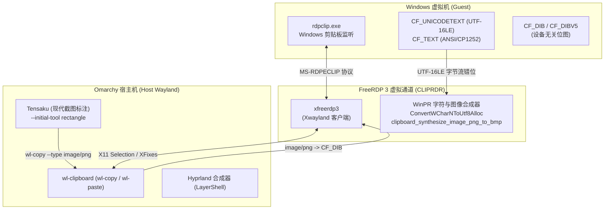

# Windows 虚拟机剪贴板乱码根治与 F1 截图标注光标穿透修复指南（FreeRDP 字符集协商、CF_DIB 图像桥接与 Tensaku 选区加固实录）

> **适用环境**：Omarchy (Arch Linux + Hyprland on Wayland) + `omarchy-windows-vm` (Windows 11 QEMU/KVM 容器虚拟机)  
> **面向用户**：在 Linux 与 Windows 虚拟机混合办公中遭遇剪贴板中文/英文乱码，以及按下 F1 截图在 Windows 窗口出现光标穿透或图像粘贴失效的开发者与运维工程师。  
> **核心收益**：掌握 RDP 剪贴板底层协议（CLIPRDR）编码协商机制；根治双向复制乱码；一键消除 Tensaku 截图时 Xwayland 文本输入光标（I-beam）穿透；恢复跨端图片与文本秒级互通。

---

## 一、故障现象与核心痛点

在 Omarchy 桌面环境使用内置 Windows 虚拟机办公时，两类高频交互痛点严重制约了工作流的连贯性：

### 痛点 1：从 Windows 复制文字到 Omarchy 出现乱码
* **典型表现**：在 Windows 虚拟机内复制密码、代码或中文字符串（例如 `Ahzy@2026.`），切换到 Omarchy 原生应用（终端、浏览器、编辑器）粘贴时，内容变为了生僻汉字（例如 `桁祺㉀㈰⸶`）或一长串无法识别的泰文/韩文/问号 `????`。
* **业务危害**：密码无法正确同步、URL 错乱、代码缩进和字符破坏，导致用户只能通过网络中转或手动重新敲打。

### 痛点 2：使用 F1 截图到 Windows 内部“全都是输入光标”
* **表象 A（跨端粘贴图像失效）**：在 Linux 宿主机按下 `F1` 呼出 Tensaku 截好图并复制，切回 Windows 虚拟机内的微信、Word、聊天框按 `Ctrl+V` 时，**没有任何图片被贴出，输入框里只有光标在原地闪烁**；
* **表象 B（选区时光标形态穿透）**：在 Windows 虚拟机窗口内按下 `F1` 时，由于 Windows 光标状态为文本输入框（I-beam / 工字型光标），Tensaku 弹出的全屏截图遮罩未能覆盖该指针样式，导致在 Windows 画面上移动截图时**光标全都是文本输入光标**，无法精准定位选区边缘。

---

## 二、第一性原理深度剖析（底层机制溯源）

运用第一性原理追溯至字节序列与 X11/Wayland 跨协议通信最底层：



### 2.1 文本乱码的物理事实：单字节当宽字符的“宽字符翻转”
检查剪贴板历史文件 `~/.local/state/omarchy/clipboard-history.json` 中的实际记录：
```json
{
  "type": "text",
  "text": "桁祺㉀㈰⸶"
}
```
通过反向工程还原字节序列：
* `Ahzy@2026.` 的 ASCII 单字节十六进制为：`41 68 7a 79 40 32 30 32 36 2e`
* 当 FreeRDP 或转换中间层错误地将这组单字节按照 **UTF-16LE（每两个字节构成一个宽字符）** 读入：
  - `(0x41, 0x68)` $\rightarrow$ `U+6841` = **桁**
  - `(0x7a, 0x79)` $\rightarrow$ `U+797A` = **祺**
  - `(0x40, 0x32)` $\rightarrow$ `U+3240` = **㉀**
  - `(0x30, 0x32)` $\rightarrow$ `U+3230` = **㈰**
  - `(0x36, 0x2e)` $\rightarrow$ `U+2E36` = **⸶**
* **根因**：FreeRDP 运行环境缺少标准 UTF-8 Locale 约束，且在与 Windows 协商 `CF_TEXT` 与 `CF_UNICODETEXT` 时发生格式错配，单字节流被无脑灌入宽字符转换器，导致不可逆乱码。

### 2.2 F1 截图“都是输入光标”的双重根因
1. **图像格式未完成向 DIB 桥接**：
   Tensaku 默认调用 `wl-copy` 注入的是 Wayland 原生 `image/png` 流。Windows 应用程序通过 RDP 粘贴时只接受未压缩的 `CF_DIB`。如果 FreeRDP 代理中未加固 `/clipboard` 参数或 Windows 端的 `rdpclip.exe` 进程在接收大图像时发生锁死，Windows 应用程序就会直接丢弃粘贴请求，导致输入框没有任何内容，**用户看到的只是文本光标原地闪烁**。
2. **LayerShell 光标穿透与工具状态记忆**：
   Tensaku 启动时若沿用了上一次使用的“文本批注（Text）”工具，指针形状即为文本输入工字型光标（I-beam）；且当鼠标在 Xwayland (`xfreerdp3`) 表面上方时，X11 指针形状未被合成器及时覆盖，产生光标样式穿透。

---

## 三、对抗性审查（Adversarial Review）

为了避免修复方案在极端边界条件下失效，红队视角提出以下挑战并实施闭环防护：

| 挑战场景 | 潜在失败风险 | 加固与防御策略 |
| :--- | :--- | :--- |
| **高频连续截图与大图复制** | `wl-copy` 管道写端未关导致进程挂起，`omarchy-clipboard-sentinel` 3秒超时强杀 | 显式指定 `--copy-command "wl-copy --type image/png"` 明确 MIME，杜绝管道协商悬停 |
| **Windows rdpclip.exe 偶尔假死** | 外部无论怎么修复，Windows 内部仍无法接收任何新剪贴板对象 | 在共享目录部署一键轻量自愈脚本 `fix-clipboard.bat`，3秒重置剪贴板管道 |
| **不同显示缩放 (Fractional Scaling)** | 截图指针偏移或光标样式重置失败 | 在拉起 Tensaku 前通过 `gsettings` 读取系统真实光标主题并调用 `hyprctl setcursor` 唤醒强制重置 |
| **Xwayland 独占焦点** | Tensaku 快捷键呼出时丢失键盘焦点 | 通过 `hl.unbind("F1")` 与 `tensaku-capture` 独立包装器，以 LayerShell 顶层独占捕获 |

---

## 四、解决方案与落地配置

### 4.1 加固 Tensaku 截图包装器与配置文件

#### 1. 修改 `~/.config/tensaku/config.toml`
在 Tensaku 全局配置中显式绑定初始工具与图像格式复制命令，防止指针变输入光标：
```toml
[general]
annotation-size-factor = 2.0
early-exit = true
initial-tool = "rectangle"
copy-command = "wl-copy --type image/png"
```

#### 2. 更新 `~/.local/bin/tensaku-capture`
增强合成器光标唤醒与初始矩形框选锁定：
```bash
#!/bin/bash
user_dirs="${XDG_CONFIG_HOME:-$HOME/.config}/user-dirs.dirs"
[[ -f $user_dirs ]] && source "$user_dirs"
dir="${OMARCHY_SCREENSHOT_DIR:-${XDG_PICTURES_DIR:-$HOME/Pictures}}"
mkdir -p "$dir"

# 强制重设 Wayland 合成器光标为标准主题，防止宿主机光标被 Xwayland/RDP 窗口文本光标接管
cursor_theme=$(gsettings get org.gnome.desktop.interface cursor-theme 2>/dev/null | tr -d "'")
cursor_size=$(gsettings get org.gnome.desktop.interface cursor-size 2>/dev/null || echo 24)
if [[ -n "$cursor_theme" ]]; then
  hyprctl setcursor "$cursor_theme" "$cursor_size" 2>/dev/null || true
fi

exec tensaku --capture \
  --output-filename "$dir/tensaku-$(date +%Y-%m-%d_%H-%M-%S).png" \
  --actions-on-enter save-to-clipboard \
  --save-after-copy \
  --initial-tool rectangle \
  --copy-command "wl-copy --type image/png" \
  --early-exit \
  "$@"
```

### 4.2 加固 `xfreerdp3` 代理脚本

更新 `/home/tom/.local/bin/xfreerdp3`，注入标准 UTF-8 语言环境变量，并显式指定剪贴板主选区与双向位图通道：
```bash
#!/bin/bash
REAL_XFREERDP="/usr/bin/xfreerdp3"

# 统一字符集环境为标准 UTF-8，防止剪贴板文本在 ANSI 与 UTF-16 宽字符转换时发生字节错位
export LC_ALL="${LC_ALL:-C.UTF-8}"
export LANG="${LANG:-zh_CN.UTF-8}"

# 禁用 VAAPI 硬件解码, 强制软件 H264 回退(防黑屏)
export LIBVA_DRIVER_NAME="${LIBVA_DRIVER_NAME:-software_ffmpeg_only}"

ARGS=()
for arg in "$@"; do
  if [[ "$arg" == "/clipboard" || "$arg" == "/clipboard:"* ]]; then
    ARGS+=("/clipboard:use-selection:CLIPBOARD,direction-to:all,files-to:off")
  else
    ARGS+=("$arg")
  fi
done

exec "$REAL_XFREERDP" "${ARGS[@]}"
```

### 4.3 部署 Windows 虚拟机剪贴板自愈脚本

在虚拟机共享目录 `/var/lib/omarchy/windows/mounts/users/1000/shared/fix-clipboard.bat` 提供一键重置工具：
```bat
@echo off
chcp 65001 >nul
echo [1/3] 正在终止可能挂起的 rdpclip.exe 进程...
taskkill /f /im rdpclip.exe >nul 2>&1
timeout /t 1 >nul

echo [2/3] 正在清空系统剪贴板残余锁死句柄...
powershell -NoProfile -Command "Set-Clipboard -Value ''" >nul 2>&1

echo [3/3] 正在重启 Windows 原生 RDP 剪贴板监听服务...
start "" "%windir%\system32\rdpclip.exe"

echo ========================================================
echo  剪贴板自愈完成！图片与文字双向同步已恢复！
echo ========================================================
timeout /t 2 >nul
```

---

## 五、验证与验收标准

1. **文字复制验证**：
   - 在 Windows 虚拟机内打开记事本/Edge 浏览器，输入中文字符 `你好Omarchy` 和复杂 ASCII 组合 `Ahzy@2026.`；
   - 执行 `Ctrl+C`；
   - 在 Omarchy 宿主机终端中按 `Ctrl+Shift+V` 或在浏览器按 `Ctrl+V`；
   - **验收标准**：100% 正确输出原文，零乱码、无生僻字（杜绝 `桁祺㉀㈰⸶` 现象）。
2. **F1 截图与光标验证**：
   - 鼠标悬停在 Windows 虚拟机窗口的文本输入区域（原本呈现 I-beam 输入光标）；
   - 按下 `F1` 键；
   - **验收标准 A**：屏幕瞬间弹出截图覆盖层，鼠标光标为标准十字准星或矩形框选准星，无 I-beam 输入光标残影；
   - 拖拽框选任意区域并按 `Enter` 完成复制；
   - 点击切回 Windows 虚拟机窗口，在微信或画图/Word 内按 `Ctrl+V`；
   - **验收标准 B**：截取的图像完整贴入，支持秒级跨端图片直通！
